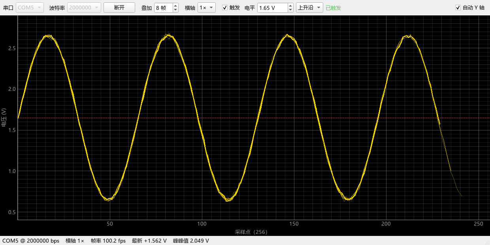

# STM32 串口示波器（触发 + 余晖 + 延长横轴）

PyQt5 + pyqtgraph 做的串口示波器：接收 STM32 的 516 字节 ADC 帧，
支持**触发电平稳定波形**、**多帧余晖叠加**和 **1×/2×/3× 横轴**。
频率计已去掉。



> 预览：1× 横轴、默认叠加 6 帧、530 Hz 正弦、触发电平 1.65 V。

## 1. 功能

- 串口/波特率下拉框，默认 `COM5 / 2000000`；
- **触发**：勾选后按「触发电平 + 上升/下降沿」对齐每一帧，波形不再左右乱跑；
- **触发电平线**：图上的红色虚线，可直接看到电平位置；
- **叠加 1~20 帧**：旧帧约 50 ms 内渐隐、新帧亮粗，类似模拟示波器余辉；
- **横轴 1× / 2× / 3×**：连续 1/2/3 帧拼成 256/512/768 点；
- **自动 Y 轴**：按当前显示的所有帧自动缩放，可取消；
- 状态栏：横轴倍数、帧率、最新电压、峰峰值。

## 2. 触发怎么用

顶部：

```
☑ 触发   电平 [1.65 V]   边沿 [上升沿]   已触发
```

- **电平**：一般设在信号中间。比如信号 0.5~2.8 V，就设 1.65 V；
- **边沿**：上升沿最常用；下降沿也可以；
- 红色虚线就是触发电平；
- 触发点固定在**屏幕最左边**，波形从触发点往后画；
- 状态标签：
  - `已触发`（绿）：至少有一帧找到了触发点，图像稳定；
  - `等待`（橙）：当前没有帧跨过这个电平，检查电平/边沿或信号幅度；
  - `关闭`（灰）：取消勾选「触发」，显示原始帧。

为什么触发点放最左边：固件每帧只有 256 个点，没有真正的“触发前数据”。
放中间就必须把帧尾硬绕到帧头，会在左半边出现竖直接缝；放左边从触发点往后画，
波形最干净。帧尾不够的部分留空，所以右边偶尔会短一截，这是正常的。

> 触发在 **1× 横轴**下最稳定。2×/3× 是拼接帧，帧间有发送间隙，接缝处仍可能跳变。

## 3. 1× / 2× / 3× 横轴

| 选项 | 每屏点数 | 组成 | 延迟 |
| --- | --- | --- | --- |
| 1× | 256 | 最新 1 帧 | 无 |
| 2× | 512 | 连续 2 帧拼接 | 约 2 帧 |
| 3× | 768 | 连续 3 帧拼接 | 约 3 帧 |

- 2×/3× 每拼满 2/3 帧才更新一次；
- 这是“拼接”，不是硬件一次连续采 512/768 点，接缝处可能有相位跳变；
- 想要真正连续的长采集，需要改固件一次采 512/768 点并改帧协议。

## 4. 文件与运行

| 文件 | 说明 |
| --- | --- |
| `main.py` | 主程序 |
| `requirements.txt` | 依赖 |
| `启动.bat` | 双击启动 |
| `预览.png` | 界面截图 |
| `README.md` | 本说明 |

```bash
pip install -r requirements.txt
python main.py
```

或双击 `启动.bat`。启动自动尝试 `COM5 / 2000000`；打不开就手动选。

配套固件在 `..\stm32示波器 模板\固件\main.c`（PA0 采集、PA1 电位器调速、2 Mbps）。

## 5. 参数

| 参数 | 默认 | 说明 |
| --- | --- | --- |
| `DEFAULT_PORT` | `COM5` | 启动串口 |
| `DEFAULT_BAUD` | `2000000` | 默认波特率 |
| `MAX_OVERLAY` | `20` | 最大叠加帧数 |
| `DEFAULT_OVERLAY` | `6` | 默认叠加帧数 |
| `AFTERGLOW_S` | `0.05` | 余晖约 50 ms 内渐隐 |
| `MAX_HISTORY` | `60` | 原始帧缓存 |
| `VOLTS_PER_LSB` | `3.3/4095` | STM32 12 位 ADC 换算 |

## 6. 常见问题

**波形还是左右跑 / 状态显示“等待”**

- 触发电平没在信号范围内：调到信号中间；
- 边沿选反了：先试上升沿；
- 信号幅度太小（< 0.05 Vpp）或一帧里没有跨过电平；
- 把 PA1 电位器调慢，让一帧里至少有一个完整周期。

**2×/3× 接缝处跳一下**

正常。帧与帧之间有发送间隙，拼接不是连续采样；稳定看图建议用 1×。

**右边波形短一截**

触发点在最左边，触发点靠后的帧，后面剩余点数少；这是没有 pre-trigger 数据的限制。

**叠加太乱**

把「叠加」调到 1，或用 1× 横轴。
