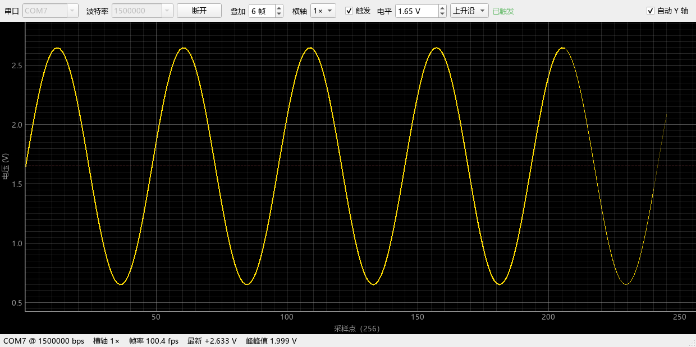

# STM32 串口示波器（触发 + 余晖 + 延长横轴 + 可输入串口/波特率）

PyQt5 + pyqtgraph 做的串口示波器：接收 STM32 的 516 字节 ADC 帧，支持触发电平稳定波形、多帧余晖叠加、1×/2×/3× 横轴，以及**手动输入串口和波特率**。

> 本目录是从原 `示波器   余晖 延长叠加 图像稳定` 目录复制后修改的 1.9.1 版本；原目录源码未修改。
> 当前版本：**1.9.1**。



## 1. 功能

- **串口可输入**：下拉框保留 COM3/4/5 常用项，也可以直接输入 `COM7`、`COM10`、`/dev/ttyUSB0` 等；
- **波特率可输入**：下拉框保留 9 档常用值，也可以直接输入 `1000000`、`1500000`、`3000000` 等；
- **输入校验**：空串口、空波特率、非整数或超出 `300~4000000` 的值会弹窗提示，不会静默退回默认值；
- 串口/波特率连接后锁定，点「断开」才能修改；
- **触发**：电平 0–3.3 V、上升/下降沿、红色电平线、状态标签；
- **余晖叠加**：1–20 帧，默认 6 帧 / 约 50 ms 渐隐；
- **横轴 1× / 2× / 3×**：连续 1/2/3 帧拼成 256/512/768 点；
- **自动 Y 轴**：按当前显示帧自动缩放，可取消；
- 状态栏：帧率、最新电压、峰峰值、横轴倍数。

## 2. 串口和波特率怎么手动输入

1. 点一下「串口」文本框，删掉原来的 `COM5`，输入实际串口，例如 `COM7`；
2. 点一下「波特率」文本框，输入数值，例如 `921600` 或 `1500000`；
3. 点「连接」。

也可以直接从下拉框选常用值。下拉框只是“快捷选项”，不会限制你输入其他值。

注意：

- 波特率必须是 **300~4000000** 的整数；
- 波特率必须和固件一致。固件默认 2 Mbps（`USART_BRR_VALUE=0x24`），改主机波特率时也要改固件；
- 串口名按设备管理器/系统实际名称填，Windows 一般是 `COMx`；
- 连接成功后窗口标题会显示实际的 `COMx @ baud`，状态栏也会显示。

## 3. 触发怎么用

- 电平一般设在信号中间（例如 0.5–2.8 V 的信号设 1.65 V）；
- 边沿先选上升沿；
- 红色虚线是触发电平；
- 状态标签：
  - `已触发`（绿）：找到触发点，图像稳定；
  - `等待`（橙）：没有帧跨过这个电平；
  - `关闭`（灰）：未勾选触发。

触发点固定在屏幕最左边，没有 pre-trigger 数据，帧尾不够时右边会短一截，这是正常的。

## 4. 1× / 2× / 3× 横轴

| 选项 | 每屏点数 | 组成 |
| --- | --- | --- |
| 1× | 256 | 最新 1 帧 |
| 2× | 512 | 连续 2 帧拼接 |
| 3× | 768 | 连续 3 帧拼接 |

2×/3× 是帧拼接，不是硬件连续采样；帧间有串口发送间隙，接缝处可能有相位跳变。稳定看图建议用 1×。

## 5. 文件和运行

| 文件 | 说明 |
| --- | --- |
| `main.py` | 主程序（本变体） |
| `requirements.txt` | 依赖 |
| `启动.bat` | Windows 一键启动 |
| `预览.png` | 界面截图 |
| `README.md` | 本说明 |

```bash
pip install -r requirements.txt
python main.py
```

或双击 `启动.bat`。启动时自动尝试 `COM5 / 2000000`；打不开就手动输入/选择。

> **不要用 `启动 - 快捷方式.lnk`**：`.lnk` 是绝对路径快捷方式，换电脑/移动目录后会失效；仓库和 Release 都不包含它。请使用本目录的 `启动.bat`，或命令行运行 `python main.py`。如果 `启动.bat` 一闪而过，在地址栏输入 `cmd` 后运行 `python main.py` 查看报错；ZIP 先解压再运行。

配套固件在 `..\firmware\main.c`：STM32F103C8T6、PA0 采集、PA1 电位器调速、USART1 DMA、默认 2 Mbps。

## 6. 参数（`main.py` 顶部）

| 参数 | 默认 | 说明 |
| --- | --- | --- |
| `DEFAULT_PORT` | `COM5` | 启动自动尝试的串口 |
| `PORT_CANDIDATES` | COM3/4/5 | 下拉框快捷项；不影响手动输入 |
| `DEFAULT_BAUD` | `2000000` | 启动波特率 |
| `BAUD_RATES` | 9 档 | 下拉框快捷项 |
| `BAUD_MIN` | `300` | 手动输入下限 |
| `BAUD_MAX` | `4000000` | 手动输入上限 |
| `MAX_OVERLAY` | `20` | 最大叠加帧数 |
| `DEFAULT_OVERLAY` | `6` | 默认叠加帧数 |
| `AFTERGLOW_S` | `0.05` | 余晖约 50 ms 渐隐 |
| `MAX_HISTORY` | `60` | 原始帧缓存 |
| `VOLTS_PER_LSB` | `3.3/4095` | STM32 12 位 ADC 换算 |

## 7. 常见问题

**串口下拉框点不动 / 灰的**

已连接时串口和波特率锁定；先点「断开」再改。

**输入了 COM7，还是打不开**

- 确认设备管理器里确实是 `COM7`，没有被别的软件占用；
- 确认 USB 转串口驱动已装；
- 如果是 `COM10` 及以上，直接输入完整名称，不要只输入数字。

**波特率输入后提示范围错误**

必须是 300–4000000 的整数，且不能为空。输入框只允许数字，但删空后点连接会提示。

**输入了 1500000，能连接但没数据**

主机和固件波特率必须一致。固件默认 2 Mbps；改固件 `USART_BRR_VALUE` 并重新烧录后，主机再填相同值。

**波形左右跑 / 状态“等待”**

- 触发电平不在信号范围内：调到信号中间；
- 边沿选反：先试上升沿；
- 信号太小或一帧里没有跨过电平；
- 把 PA1 电位器调慢，让一帧里至少有一个完整周期。

**2×/3× 接缝跳一下**

正常。帧与帧之间有串口发送间隙，拼接不是连续采样；稳定看图用 1×。

**右边波形短一截**

触发点在屏幕最左，触发点靠后的帧剩余点数少；没有 pre-trigger 数据，属正常。

## 8. 版本

| 版本 | 变更 |
| --- | --- |
| **1.8.1** | 基础稳定版：触发、余晖、1×/2×/3×、自动 Y；串口/波特率仅下拉选择 |
| **1.9** | 串口和波特率可手动输入；保留原下拉快捷项；增加空值/范围/非整数校验 |
| **1.9.1** | 当前发布版：完善输入校验提示、版本目录/预览/README 打包；协议和波形处理不变 |

1.9.1 只改上位机输入方式，**不改 516 字节协议**，可以配同一份固件使用。
