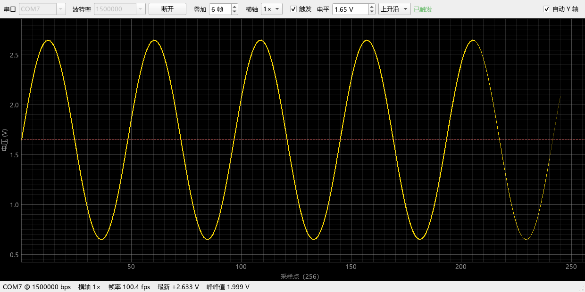

# STM32 Serial Oscilloscope

A low-cost STM32F103C8T6 + PC oscilloscope. The MCU streams 12-bit ADC samples over a 2 Mbaud UART link; a PyQt5/pyqtgraph desktop app renders them with persistence, triggering and an extended time base.



> Current stable release: **v1.9.1** · single channel · 256 samples/frame · 516-byte frames.

## Features

- **256 samples per frame**, `AA 55 + 256 × int16 + 5A A5` (516 bytes), 8-N-1.
- **2 Mbaud** default; **COM port and baud rate are editable** (type `COM7`, `COM10`, `1500000`, etc.).
- **Input validation**: empty port, empty baud, non-integer or out-of-range values are rejected with a message; no silent fallback.
- **Auto Y** with margin, smooth shrink and freeze.
- **Persistence/afterglow**: 1–20 overlaid frames, time-based fade (50 ms by default).
- **Trigger**: level + rising/falling edge, red level line, status indicator; trigger point fixed at the left edge for a stable 1× trace.
- **X-axis 1× / 2× / 3×**: concatenates 1/2/3 frames into 256/512/768 points.
- **1× is the recommended stable view**; 2×/3× are frame-concatenated and may show seams.
- **Frequency counter removed** from the current stable build (legacy branches only).

## Hardware

| STM32 pin | Connect to | Notes |
| --- | --- | --- |
| `PA0` | Analog signal | 0–3.3 V only; add protection/attenuation externally if needed |
| `PA1` | 10 kΩ pot wiper | Pot ends to 3.3 V and GND; adjusts sample interval |
| `PA9` | USB-UART **RX** | USART1 TX, 2 Mbaud |
| `PA10` | USB-UART **TX** | USART1 RX |
| `GND` | USB-UART GND | Common ground is required |
| `3.3V` | 3.3 V rail | Power the board from USB or a clean 3.3 V supply |
| `PA13` / `PA14` | ST-Link SWDIO / SWCLK | Flashing/debug |

Use a USB-UART adapter that reliably supports **2 Mbaud** (CH340, CP2102 or FT232 are typical choices). The board itself is a standard STM32F103C8T6 “Blue Pill”.

## Repository layout

```
.
├── main.py                 # PC host (PyQt5 + pyqtgraph)
├── requirements.txt
├── 启动.bat                # Windows one-click launcher
├── 预览.png
├── firmware/
│   ├── main.c              # STM32F103C8T6 acquisition firmware
│   └── README.md
├── docs/
│   └── protocol.md         # 516-byte frame / timing specification
├── README.md
├── README_zh.md
├── LICENSE
└── VERSION
```

## Quick start

```bash
python -m venv .venv
.venv\Scripts\activate        # Windows
pip install -r requirements.txt
python main.py
```

On Windows you can also double-click `启动.bat`. The app tries `COM5 / 2000000` at startup; type or select the correct port/baud and press **Connect**.

### Windows launcher / shortcut

Use **`启动.bat`** (or run `python main.py` in the repository root). **Do not use `启动 - 快捷方式.lnk`**: a `.lnk` file stores an absolute path from the author’s machine, so it breaks after downloading, moving folders or using another PC. `.lnk` files are intentionally not shipped (`.gitignore` ignores `*.lnk`).

If `启动.bat` closes immediately, open a terminal in the repository root and run:

```bat
python main.py
```

Then fix the reported error (Python not on PATH, missing `PyQt5/pyqtgraph/pyserial/numpy`, or running from inside the ZIP without extracting it). Extract the ZIP first; if Windows blocks the downloaded archive, open its Properties and check **Unblock** before extracting.

The serial port field accepts arbitrary names (for example `COM7`, `COM10`, `/dev/ttyUSB0`). The baud rate field accepts integers from **300 to 4,000,000**; the drop-down entries are shortcuts only. The baud rate must match the firmware.

## Protocol

```
offset  size  field
0       2     header   AA 55
2       512   256 × int16 little-endian ADC codes (0…4095)
514     2     tail     5A A5
```

Voltage: `V = code × 3.3 / 4095`.

The link has no CRC, sequence number or timestamp. The host resynchronises by scanning for `AA 55` and verifying `5A A5`; malformed candidates are skipped one byte at a time.

See **[docs/protocol.md](docs/protocol.md)** for the full frame/timing specification and parser examples.

## Build the firmware

The stable acquisition firmware is `firmware/main.c`:

- STM32F103C8T6, 72 MHz from an 8 MHz HSE, USART1 at 2 Mbaud, USART1 TX DMA.
- 256-point polling ADC on PA0; PA1 potentiometer sets the per-sample delay (0–200 µs).
- Keil MDK-ARM 5 / ARMCC 5.06 with the STM32F1 StdPeriph library.
- Clock, pin and USART settings are in the source header comments.

See **[firmware/README.md](firmware/README.md)** for the Keil project setup, clock/baud notes and flashing steps.

## Release

Download the latest build from the GitHub Releases page:

**https://github.com/HenAcxklo/STM32-Oscilloscope/releases/tag/v1.9.1**


## Known limitations

- The trigger point is at the left edge; there is no pre-trigger history, so the right edge of a frame may be short.
- 2×/3× concatenate separate UART frames; the seams are not continuous hardware sampling.
- No CRC, frame counter or timestamp; a noisy 2 Mbaud link can drop frames.
- Input range is 0–3.3 V; there is no attenuation, offset or input protection on the board.
- Voltage conversion is `3.3 / 4095` for the current STM32 internal ADC. An earlier ADS1115 build used ±4.096 V and `0.000125` V/LSB; the frame layout is the same but the coefficient is different.
- Port/baud are editable but the baud rate must match the firmware; 300–4,000,000 is the host-side accepted range.
- The current host has no run/stop, vertical-gain or timebase knob; use auto-Y, the PA1 pot and 1×/2×/3×.

## License

MIT License — see [LICENSE](LICENSE).

## Version history

| Version | Changes |
| --- | --- |
| **1.0** | First working scope: 256-point single-frame display, 516-byte UART frame, ADS1115/STM32-compatible acquisition. |
| **1.1** | Runtime COM-port and 9 baud-rate selection; connect/disconnect without editing code. |
| **1.2** | Auto Y range with margin, immediate expansion, smooth shrink and freeze. |
| **1.3** | Multi-frame persistence/afterglow, 1–20 frames with age-based brightness. |
| **1.4** | Frequency estimate from zero crossings and the frame-rate-derived sample rate. |
| **1.5** | 1×/2×/3× X-axis by concatenating 1/2/3 frames (256/512/768 points). |
| **1.6** | Trigger level/edge, red level line and status; trigger point moved to the left edge; NaN tail instead of circular wrap; frequency counter removed from the stable build. |
| **1.7** | Time-based afterglow (~50 ms, default 6 frames); auto Y now uses only visible frames; fixes long lingering trails. |
| **1.8** | Firmware hardening: 7.5-cycle ADC sampling, EOC/calibration cleanup, DMA flag/CNDTR initialisation, timeout guards. |
| **1.8.1** | Bug-fix/compatibility release: Qt binding guard, serial reconnect/close cleanup, frame resync, NaN-safe auto Y, documentation. No protocol change. |
| **1.9** | Editable COM-port and baud-rate input (300–4,000,000), preserving the preset drop-downs; explicit validation instead of a silent default fallback. |
| **1.9.1** | **Current release**: input validation/packaging pass for the editable port/baud build; flattened repository layout; documentation and preview updated. No protocol change. |

The project is feature-complete for this hardware. Future work is limited to bug fixes and compatibility; the wire protocol is frozen at v1.
