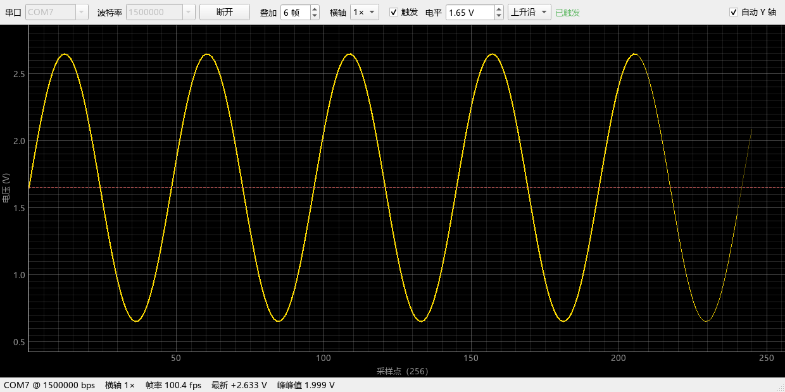

# STM32 串口示波器（Blue Pill + PC）

用一块十几块钱的 **STM32F103C8T6 最小系统板** 加一个 USB 转串口，做成一台能看波形、能触发、有余晖的简易数字示波器。下位机采 256 点，通过 **2 Mbps** 串口发 516 字节一帧；上位机用 **PyQt5 + pyqtgraph** 实时画图。



> 当前稳定版：**v1.9.1**；单通道、256 点/帧、516 字节/帧；串口/波特率可手动输入。

---

## 1. 背景

市面上的入门示波器要么贵，要么带宽/存储不够；而 STM32F103C8T6 自带 12 位 ADC，USB 转串口在 2 Mbps 下也足够传 256 点波形。这个项目就是把“单片机采集 + 串口协议 + PC 显示”做成一个完整、可复现的小产品：

- 下位机只做一件事：按 PA1 电位器设定的间隔采 256 点，打包，DMA 发走；
- 上位机负责协议解析、自动 Y、余晖、触发、横轴扩展；
- 不依赖昂贵仪器，USB 供电即可工作；
- 代码保持单文件上位机 + 单文件固件，方便修改和教学。

设计取舍是“**稳定、简单、能复现**”，不是追求高带宽。当前版本功能已经冻结，后续只修 bug 和兼容性问题。

---

## 2. 功能

- **串口/波特率**：可手动输入 COMx 和 300–4000000 的波特率；下拉框保留 COM3/4/5 与 9 档快捷值，连接后锁定，可断开重连；
- **单帧 256 点**：按 `AA 55 + 256×int16 + 5A A5` 解析，假帧头自动跳过重同步；
- **自动 Y 轴**：按当前显示帧自动缩放，扩张立即、收缩平滑，可取消勾选冻结；
- **余晖叠加**：1–20 帧，旧帧按时间渐隐，默认 **50 ms / 6 帧**；
- **触发**：触发电平 0–3.3 V、上升/下降沿、红色电平线、状态提示；
- **1× / 2× / 3× 横轴**：把连续 1/2/3 帧拼成 256/512/768 点；
- **状态栏**：帧率、最新电压、峰峰值、横轴倍数；
- **稳定优先**：触发点固定在屏幕最左边，没有 pre-trigger 数据时不做循环绕回，避免左侧竖直接缝。

> 频率计在 1.6 版从稳定分支移除。它依赖“帧率反推采样率”，在 2×/3× 拼接和不同固件节奏下容易误导；需要频率请用示波器/信号源，或参考旧版 `频率计` 分支。

---

## 3. 仓库结构

```
.
├── 1.8.1/                    # 上一版上位机（仅下拉选择）
├── 1.9.1/                    # 当前上位机（串口/波特率可输入）
│   ├── main.py
│   ├── requirements.txt
│   ├── 启动.bat
│   ├── README.md
│   └── 预览.png
├── firmware/
│   ├── main.c                # STM32F103C8T6 采集固件
│   └── README.md             # Keil 工程/烧录说明
├── docs/
│   └── protocol.md           # 串口帧格式与时序
├── README.md                 # English, short
├── README_zh.md              # 本文件
└── VERSION
```

---

## 4. 硬件与接线

### 4.1 需要的东西

- STM32F103C8T6 最小系统板（Blue Pill）；
- USB 转串口模块（CH340 / CP2102 / FT232 等，确认能稳定跑 2 Mbps）；
- 10 kΩ 电位器一只；
- ST-Link（第一次烧录/调试用）；
- 杜邦线、USB 供电。

### 4.2 接线

| STM32 引脚 | 接到 | 说明 |
| --- | --- | --- |
| `PA0` | 被测信号 | **0–3.3 V**，超压会损坏 ADC；必要时外加衰减/保护 |
| `PA1` | 10 kΩ 电位器中间抽头 | 两端分别接 3.3 V 和 GND；调采样速度 |
| `PA9` | USB 转串口 **RX** | USART1 TX，2 Mbps |
| `PA10` | USB 转串口 **TX** | USART1 RX |
| `GND` | USB 转串口 GND | 必须共地 |
| `3.3V` | 3.3 V | 可用板载稳压输出；不要同时用 USB 和外接 5 V 硬怼 |
| `PA13` | ST-Link SWDIO | 烧录/调试 |
| `PA14` | ST-Link SWCLK | 烧录/调试 |

> 注意：这是 **3.3 V ADC**，不是 ADS1115 的 ±4.096 V。上位机按 `3.3 / 4095` 换算；输入超过 3.3 V 必须先分压。

### 4.3 采样速度

PA1 电位器把采样间隔调到 **约 1.7–201.7 µs**（ADC 转换 1.667 µs + 0–200 µs 延时）：

- 采样率约 **5 kSPS–500 kSPS**（0 延时理论可到 600 kSPS，实际轮询有开销）；
- 256 点窗口约 **0.43–51.6 ms**；
- 2 Mbps 下帧率约 **19–330 fps**（还要加上 516 字节发送时间 2.58 ms）。

实际帧率以状态栏为准；2 Mbps 串口本身的理论上限约 **388 fps**。

---

## 5. 固件

### 5.1 当前固件做什么

`firmware/main.c` 是稳定采集固件：

1. HSE 8 MHz → PLL ×9 → 72 MHz；ADC 时钟 12 MHz；
2. PA0 模拟输入，7.5 周期采样；PA1 电位器 55.5 周期采样；
3. 每帧：读 4 次 PA1 求平均 → 映射成 0–200 µs 延时 → 采 256 点 PA0；
4. 打包 `AA 55 + 256×int16 LE + 5A A5`；
5. USART1 2 Mbps，DMA1 通道 4 发送，等发完再采下一帧。

这样“帧周期 = 采样窗口 + 串口发送时间”，上位机的时间轴/频率模型才成立；固件不会在串口发不完时丢帧。

### 5.2 编译/烧录

- Keil MDK-ARM 5.x，ARMCC 5.06；
- 器件 `STM32F103C8`，StdPeriph 库，启动文件 `startup_stm32f10x_md.s`；
- 宏：`STM32F10X_MD`、`USE_STDPERIPH_DRIVER`；
- 8 MHz 外部晶振，72 MHz 主频；
- 编译后 ST-Link 下载到 `0x08000000`。

更细的工程配置、波特率修改和常见编译问题见 **[firmware/README.md](firmware/README.md)**。

---

## 6. 上位机使用

### 6.1 运行

```bash
cd 1.9.1
python -m venv .venv
.venv\Scripts\activate
pip install -r requirements.txt
python main.py
```

Windows 也可以直接双击 `1.9.1\启动.bat`。启动后默认尝试 `COM5 / 2000000`；如果打不开，直接在「串口」「波特率」输入框里改成实际值，点「连接」。

#### 启动方式和“快捷方式打不开”

- **不要用 `启动 - 快捷方式.lnk`**：`.lnk` 是 Windows 绝对路径快捷方式，指向原作者的目录；换电脑、移动文件夹、从 GitHub 下载后都会失效。仓库和 Release 都不包含 `.lnk`（`.gitignore` 已忽略 `*.lnk`）。
- 正确启动：进入 `1.9.1` 文件夹，双击 **`启动.bat`**；或者在该文件夹打开命令行，运行 `python main.py`。
- 如果 `启动.bat` 一闪而过：在 `1.9.1` 文件夹地址栏输入 `cmd` 回车，再运行 `python main.py`，看具体报错。常见原因是 Python 没装/没进 PATH、依赖没装，或者直接在压缩包里双击没有先解压。
- 从 GitHub 下载的 ZIP 先解压再运行；Windows 可能锁定下载文件，右键 ZIP → 属性 → 勾选“解除锁定”后再解压。

### 6.2 顶部控件

- **串口 / 波特率**：下拉框可编辑，直接输入 `COM7`、`COM10`、`/dev/ttyUSB0` 等串口，以及 `1000000`、`1500000`、`3000000` 等波特率；下拉项只是快捷值；连接后锁定，先「断开」再改；
- **叠加**：1–20 帧，默认 6；余晖约 50 ms 渐隐；
- **横轴**：1× / 2× / 3×；
- **触发**：勾选后设置电平（0–3.3 V）和边沿（上升/下降）；
- **自动 Y 轴**：默认勾选；取消后纵轴冻结。

### 6.3 触发怎么调

1. 先不勾触发，看信号大致范围；
2. 把电平设在信号中间（例如 0.5–2.8 V 的信号设 1.65 V）；
3. 边沿先选上升沿；
4. 勾选触发，看状态：
   - `已触发`（绿）：稳定；
   - `等待`（橙）：没有帧跨过电平，检查电平/边沿/幅度；
   - `关闭`（灰）：未勾选。

触发点在最左边，波形从触发点往后画；帧尾不够的部分留空，所以右边偶尔短一截，这是没有 pre-trigger 数据的正常现象。

### 6.4 1× / 2× / 3×

- 1×：256 点，最新一帧，**最稳定，推荐**；
- 2×：连续 2 帧拼成 512 点；
- 3×：连续 3 帧拼成 768 点；
- 2×/3× 帧间有串口发送间隙，接缝处可能相位跳变；要真正连续长采集，需要改固件一次采 512/768 点并改协议。

---

## 7. 串口协议

每帧固定 516 字节：

| 偏移 | 长度 | 内容 |
| --- | --- | --- |
| 0 | 2 | 帧头 `AA 55` |
| 2 | 512 | 256 个 `int16`，小端，ADC 码值 0–4095 |
| 514 | 2 | 帧尾 `5A A5` |

电压：

```
V = code × 3.3 / 4095
```

- UART：8-N-1，无流控，默认 2,000,000 bps；
- 无 CRC、无帧序号、无时间戳；
- 上位机扫描 `AA 55`，凑满 516 字节后校验 `5A A5`，失败丢 1 字节重同步。

完整字段、拼帧伪代码、时序和旧版频率估算见 **[docs/protocol.md](docs/protocol.md)**。

---

## 8. 实测性能

测试条件：STM32F103C8T6 @72 MHz，USB 转串口 2 Mbps，PA1 电位器中速，530 Hz 正弦，触发 1.65 V。

- 帧长 516 字节，2 Mbps 理论 **387.6 fps**；
- 固件实测约 **19–330 fps**（取决于 PA1 延时；串口发送占 2.58 ms/帧）；
- 上位机刷新周期 30 ms（约 33 FPS），只画最新帧；
- 1× 256 点，触发后波形稳定；
- 余晖默认 6 帧 / 50 ms，旧帧渐隐；
- 2×/3× 能显示 512/768 点，但接缝处可能有跳变；
- 频率计已从当前版本移除；旧版估算误差约 ±几 %，仅供定性参考。

> 这些是“能稳定用”的实测值，不是实验室计量指标；ADC 非线性、VDDA 实际电压、USB 转串口质量都会影响绝对精度。

---

## 9. 已知限制

- **没有 pre-trigger**：触发点固定最左边，右边可能短一截；
- **2×/3× 有接缝**：是帧拼接，不是硬件连续采样；
- **无 CRC/帧号/时间戳**：2 Mbps 线材差或干扰大时可能丢帧，协议只能重新同步；
- 单通道、0–3.3 V：没有衰减、偏置、输入保护；
- 电压系数是 `3.3 / 4095`。早期 ADS1115 版本用 ±4.096 V、系数 `0.000125`；帧格式一样，但系数不能混用；
- **没有垂直增益/时基旋钮**：纵轴靠自动 Y，横轴靠 PA1 和 1×/2×/3×；
- **频率计已移除**：旧版频率分支依赖帧率反推采样率，固件节奏一变就不准；
- **串口/波特率可手输**：范围 300–4000000；下拉只是快捷项；必须和固件一致；空值/非整数/超范围会提示；
- **Windows 为主**：`启动.bat` 是 Windows 批处理；Linux/macOS 手动装依赖运行；
- **无校准**：默认 VDDA = 3.3 V，实际板子可能有 1–2% 偏差。

### 开发支线（未纳入稳定版）

历史对话里还验证过两条支线，但**没有进入本仓库的稳定固件/协议**：

- **TIM3 触发 ADC + DMA**：采样时刻由硬件定时，DAC 的 I2C 中断不会改变采样点；但帧首 DMA/ADC 对齐需要额外处理，且与“采一帧→发一帧”的上位机时间模型要重新对齐；
- **MCP4725 DAC 正弦输出**：I2C1 PB6/PB7，400 kHz，TIM4 3.2 kHz / 64 点 ≈ 50 Hz；每次 I2C 写约 72 µs，约占 23% CPU。

这两条支线不改变 516 字节帧格式；如果以后要做“边采集边输出”，可以在独立分支继续，不影响当前稳定版。

---

## 10. 发布与下载

GitHub Releases：

**https://github.com/HenAcxklo/STM32-Oscilloscope/releases**

建议每个版本打 tag（当前为 `v1.9.1`），Release 附件放：

- `STM32-Serial-Oscilloscope-v1.9.1.zip`：上位机 + 固件源码 + 文档；
- 可选：编译好的 `.hex` / `.bin`（注明板子和时钟配置）。

推送/更新：

```bash
git init
git add .
git commit -m "STM32 serial oscilloscope v1.9.1"
git branch -M main
git remote add origin https://github.com/HenAcxklo/STM32-Oscilloscope.git
git push -u origin main
git tag v1.9.1
git push origin v1.9.1
```

然后在 GitHub 的 **Releases → Draft a new release** 里选 `v1.9.1`，上传 zip 即可。

## 11. 许可证

MIT License，见 [LICENSE](LICENSE)。

---

## 12. 致谢


- STM32F103C8T6 / Blue Pill 社区；
- PyQt5、pyqtgraph、pyserial、NumPy；
- 以及所有帮忙实测、反馈波形和协议问题的朋友。

## 13. 版本历史

> 规则：每新增一个功能模块 +0.1；纯 bug 修复/兼容性用 1.9.x。协议从 1.0 起保持 516 字节不变。

| 版本 | 新增 | 修复/调整 |
| --- | --- | --- |
| **1.0** | 基础串口示波器：256 点采集、516 字节帧、单帧显示；ADS1115/STM32 帧兼容 | 建立 `AA 55 … 5A A5` 拼帧与假帧头重同步；后续 STM32 内部 ADC 沿用同一帧格式，电压系数改为 `3.3/4095` |
| **1.1** | 串口/波特率模块：COM3/4/5、9 档波特率、连接/断开 | 连接中锁定下拉框；打开失败不再直接退出；窗口标题显示实际连接 |
| **1.2** | 自动 Y 轴模块：按帧自动缩放、上下余量、冻结 | 扩张立即、收缩平滑；最小跨度/最大范围限制，避免噪声压扁波形 |
| **1.3** | 多帧余晖模块：1–20 帧叠加、按年龄调亮度 | 自动 Y 按叠加帧计算；旧帧不再只留最后一帧 |
| **1.4** | 频率计模块：过零插值 + 帧率反推采样率 + 中位数 | 频率显示带 `≈`，说明是估算；低频/小信号时显示 `---` |
| **1.5** | 延长横轴模块：1×/2×/3×，连续 1/2/3 帧拼 256/512/768 点 | 切换倍数时用历史帧立即重组；状态栏显示横轴倍数和拼接延迟 |
| **1.6** | 触发模块：电平 0–3.3 V、上升/下降沿、红色电平线、状态标签 | 触发点固定屏幕最左，帧尾用 NaN 补齐，修掉“触发点放中间导致左侧循环绕回/竖直接缝”；稳定分支移除频率计 |
| **1.7** | 时间余晖模块：旧帧约 50 ms 渐隐、默认 6 帧、最多 20 帧 | 修掉“旧帧只按序号变暗、慢采样时余晖拖太久”；自动 Y 只统计实际可见帧 |
| **1.8** | 固件加固：7.5 周期采样、校准/EOC 清理、DMA 标志/CNDTR 初始化、超时保护 | 修第一帧异常/旧值、DMA 残留标志、校准或 EOC 卡死；2 Mbps + USART DMA 稳定 |
| **1.8.1** | bugfix/兼容版：文档、启动脚本、Qt 绑定保护 | 修 Qt 绑定选错、串口拔出/关窗线程残留、假帧头重同步边界、自动 Y 遇 NaN 计算错误；协议不变 |
| **1.9** | 串口/波特率手输模块：下拉框可编辑，保留快捷项，范围 300–4000000 | 修掉“输入非法值静默回退默认波特率”；空值/非整数/超范围改为明确提示 |
| **1.9.1** | 当前发布版：1.9 手输功能的校验/打包/文档，仓库按 `1.8.1/`、`1.9.1/` 版本目录整理 | 修输入校验提示、版本目录引用和预览；协议不变 |

**当前版本：1.9.1（功能冻结）**。后续只接受：

- bug 修复；
- 兼容性修复（Python/PyQt5/pyqtgraph/串口芯片）；
- 文档修正。

不再新增功能模块，避免破坏 1.0 以来固定的 516 字节协议和 2 Mbps 时序模型。
